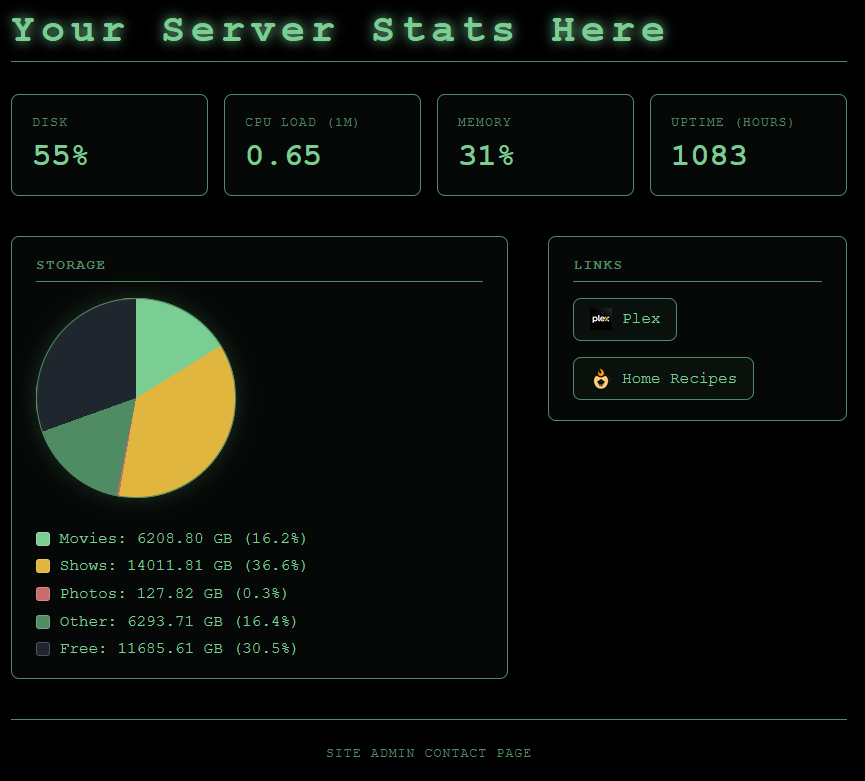

# 🎭 curtain

> *"Pay no attention to the man behind the curtain."*

**curtain** is a public-facing dashboard for an Unraid (or any Linux) home server.
It shows visitors a curated, admin-approved view of the machine — live metrics,
storage usage, and quick links to your public services — **with no login required
and nothing sensitive ever exposed.**

The name fits the intent: it's the *public front* of the server — what's on
stage, never backstage.



---

## Features

- **Live server metrics** — CPU load, memory usage, uptime, and disk usage, refreshed automatically.
- **Storage breakdown** — a pie chart of up to three named paths (e.g. *Movies*, *Shows*, *Photos*), plus *Other* used space and *Free* space.
- **Quick links** — admin-defined links to your services, each with an optional custom icon. No service support is hard-coded; add anything.
- **Customizable** — set the dashboard title and a footer contact/portfolio link via environment variables.
- **Wizard-of-Oz theme** — an Emerald City black-and-green aesthetic.
- **Fails gracefully** — any unavailable metric shows "unavailable" instead of breaking the page.

## Built for safety

curtain is designed from the ground up to sit on a **public, unauthenticated**
surface in front of a real home server. Security outranks every other concern:

- **Read-only by default.** There are no write, control, or configuration endpoints — curtain can only *read and display*.
- **Allowlist, not passthrough.** The admin explicitly opts each metric, path, and link *in* via environment variables. Nothing is exposed by default; raw system interfaces, `/proc`, and Docker sockets are never proxied to the browser.
- **No secrets reach the client.** Responses contain only safe aggregate numbers and admin-chosen labels — never hostnames, internal IPs, filesystem paths, usernames, or environment secrets.
- **Hardened static serving.** The built-in file server is path-traversal protected (containment-checked against the web root).
- **Locked-down container.** Ships as a minimal, **non-root** image with **all Linux capabilities dropped**, `no-new-privileges`, a **read-only root filesystem**, and your data **bind-mounted read-only**. Even a fully compromised container cannot alter your files.
- **Security headers** (CSP, `X-Content-Type-Options`, `X-Frame-Options`, `Referrer-Policy`, `Permissions-Policy`) on every response.

## Tech stack

- **Backend:** Node.js (ESM), **zero runtime dependencies** — metrics come from Node's built-in `os` and `fs` modules; nothing is shelled out.
- **Frontend:** React + Vite, compiled to static files.
- **Delivery:** a minimal multi-stage Docker image (~170 MB) — the build toolchain and dev dependencies never ship.

---

## Quick start (Docker)

The image is published on Docker Hub as [`ggarden/curtain`](https://hub.docker.com/r/ggarden/curtain).

### docker run

```bash
docker run -d --name curtain \
  -p 1939:1939 \
  -e SERVER_NAME="My Server" \
  -e DISK_PATH=/data/movies \
  -e STORAGE_1_NAME=Movies -e STORAGE_1_PATH=/data/movies \
  -e STORAGE_2_NAME=Shows  -e STORAGE_2_PATH=/data/shows \
  -e LINK_1_LABEL=Plex -e LINK_1_URL=http://192.168.1.10:32400 -e LINK_1_ICON=/logos/plex.png \
  -v /mnt/user/Movies:/data/movies:ro \
  -v /mnt/user/Shows:/data/shows:ro \
  --cap-drop ALL \
  --security-opt no-new-privileges \
  --read-only \
  ggarden/curtain:latest
```

Then open **http://localhost:1939** (or point your reverse proxy at it).

### docker compose

```yaml
services:
  curtain:
    image: ggarden/curtain:latest
    container_name: curtain
    restart: unless-stopped
    ports:
      - "1939:1939"
    environment:
      SERVER_NAME: "My Server"
      CONTACT_URL: "https://example.com"
      DISK_PATH: /data/movies
      STORAGE_1_NAME: Movies
      STORAGE_1_PATH: /data/movies
      STORAGE_2_NAME: Shows
      STORAGE_2_PATH: /data/shows
      STORAGE_3_NAME: Photos
      STORAGE_3_PATH: /data/photos
      LINK_1_LABEL: Plex
      LINK_1_URL: "http://192.168.1.10:32400"
      LINK_1_ICON: /logos/plex.png
      LINK_2_LABEL: Jellyfin
      LINK_2_URL: "http://192.168.1.10:8096"
      LINK_2_ICON: /logos/jellyfin.png
    volumes:
      - /mnt/user/Movies:/data/movies:ro
      - /mnt/user/Shows:/data/shows:ro
      - /mnt/user/immich:/data/photos:ro
    cap_drop:
      - ALL
    security_opt:
      - no-new-privileges:true
    read_only: true
```

```bash
docker compose up -d
```

> **On Unraid:** install the **Community Applications** plugin, then the
> **Docker Compose Manager** plugin, and add the compose file above as a stack.
> If storage sizes read as `0`, the container user can't read your shares — add
> `user: "99:100"` (matching Unraid's `nobody:users`).

---

## Configuration

All configuration is supplied through environment variables (Docker `-e` / compose
`environment:`). Only these specific, named variables are read — curtain never
enumerates the environment, so your other secrets stay invisible.

### General

| Variable | Required | Description |
|---|---|---|
| `SERVER_NAME` | No | Dashboard title. Defaults to `curtain`. Rendered exactly as typed. |
| `CONTACT_URL` | No | A footer link to the maintainer's site/portfolio/contact page. Shown only if it is a valid `http(s)` URL. |
| `DISK_PATH` | No | Path whose filesystem total/free is reported (drives the "Disk" metric and the pie's *Free*/*Other*). Point it at a mounted path on your storage volume. Defaults to `/`. |

### Storage pie (up to 3)

Each entry needs **both** a name and a path. `n` is `1`, `2`, or `3`.

| Variable | Description |
|---|---|
| `STORAGE_<n>_NAME` | Display label for the wedge (e.g. `Movies`). |
| `STORAGE_<n>_PATH` | Directory to measure. In a container this is the **in-container mount target**. |

Measured directories become pie wedges; the rest of the used space becomes
*Other*, plus a *Free* slice. (More than three paths are ignored with a log
warning — extras fold into *Other*.)

### Quick links (up to 12)

Each entry needs a label and a valid `http(s)` URL; the icon is optional. `n` is
`1`–`12`, numbered sequentially.

| Variable | Required | Description |
|---|---|---|
| `LINK_<n>_LABEL` | Yes | Link text (e.g. `Plex`). |
| `LINK_<n>_URL` | Yes | Target URL. Must be `http(s)`; invalid URLs are dropped. |
| `LINK_<n>_ICON` | No | Icon image. A local path like `/logos/plex.png` (self-hosted, recommended) or an external `http(s)` image URL. |

> **Self-hosted icons** live in `client/public/logos/` and are baked into the
> image at build time. External icon URLs work too, but cause visitors' browsers
> to fetch from that third party — self-hosting is preferred.

---

## Storage & read-only mounts

A container can't see the host filesystem unless you mount it. To report a path's
size, **bind-mount it into the container read-only** and point the matching
`STORAGE_<n>_PATH` at the in-container target:

```
-v /mnt/user/Movies:/data/movies:ro      ->   STORAGE_1_PATH=/data/movies
```

Read-only (`:ro`) is deliberate: curtain only ever *reads*, so even a compromise
can't modify or delete your media. The set of mounts you provide **is** the
allowlist of what curtain can see.

---

## Development

Requires Node.js 22+.

```bash
git clone https://github.com/ggardenhire/curtain.git
cd curtain

# install the front-end's build tooling
cd client && npm install && cd ..

# create a local .env (gitignored) with your config, then run the backend
node --env-file=.env server.js            # API + metrics on :1939

# in a second terminal, run the Vite dev server (hot reload)
cd client && npm run dev                  # UI on :5173, proxies /api -> :1939
```

Open **http://localhost:5173** during development. Vite proxies `/api/*` to the
backend, mirroring the single-origin setup used in production.

The backend has no dependencies to install — it runs on Node built-ins.

## Building the image

```bash
docker build -t curtain:latest .
```

A multi-stage build compiles the React app in a full-toolchain stage, then copies
only the compiled output into a minimal runtime image that serves the static
files and the `/api/*` JSON.

---

## License

[MIT](LICENSE) © Garret Gardenhire
